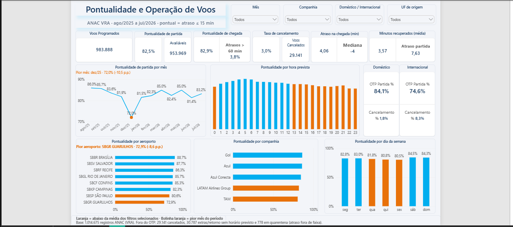

# Pontualidade e Operação de Voos (ANAC VRA)

Análise de pontualidade, atrasos e cancelamentos de voos no Brasil entre agosto/2025 e julho/2026, com dados públicos da ANAC. O resultado é um dashboard de uma página no Power BI, alimentado por um pipeline Bronze/Silver/Gold no Databricks e por um banco PostgreSQL no Supabase.



> Projeto independente de portfólio. Não é um produto oficial da ANAC.

## Pergunta de negócio

Quando e onde a pontualidade de partida cai abaixo da média do período, e quanto isso pesa em atrasos e cancelamentos?

## Principais resultados

Pontual = atraso de até 15 minutos.

- 82,5% das partidas e 82,9% das chegadas foram pontuais. O voo típico chega adiantado (mediana de −4 min), mas 3,8% das chegadas atrasam mais de 60 min.
- Dezembro/2025 foi o pior mês, com 72,0% de pontualidade de partida.
- A pontualidade cai a partir das 13h e é menor às sextas (80,5%).
- Entre os 8 aeroportos exibidos, Guarulhos tem a menor pontualidade (72,9%).
- Voos internacionais: 74,6% de pontualidade e 8,3% de cancelamento, contra 84,1% e 1,8% no doméstico.
- 3,0% dos voos programados foram cancelados (29.141).

## Como foi feito

CSVs mensais da ANAC → Databricks (Bronze, Silver, Gold) → PostgreSQL (Supabase) → Power BI

- **Databricks (PySpark, Delta Lake):** pipeline em camadas, construído a partir do material da Imersão Databricks da Alura.
- **PostgreSQL:** migração das tabelas `fato_voos` e `dim_aeroporto`, com validações e correções em SQL.
- **Power BI:** modelo dimensional (fato de voos, aeroportos de origem e destino e calendário), medidas em DAX e o dashboard.

O passo a passo para reproduzir está em [`docs/pipeline-e-modelagem.md`](./docs/pipeline-e-modelagem.md).

## Definições que sustentam os números

- A pontualidade é calculada sobre os **voos avaliáveis** (953.969), que têm horário previsto e realizado. Sobre todos os registros, seria 77,5%.
- O cancelamento é calculado sobre os **voos programados** (983.888).
- Ficam fora da pontualidade: 29.141 cancelados, 30.787 etapas extras ou de retorno sem horário previsto e 778 voos em quarentena (atraso fora de faixa). O rodapé do dashboard mostra esses números.
- Doméstico e internacional seguem o tipo de linha informado pela ANAC.
- Na dimensão de aeroportos, o país foi corrigido pelo prefixo ICAO e dois aeroportos sem UF (Corumbá e Imperatriz) foram preenchidos.

Detalhes e consultas em [`docs/decisoes-metodologicas.md`](./docs/decisoes-metodologicas.md).

## Limitações

- Os dados mostram quando e onde os atrasos acontecem, não o motivo.
- São 12 meses: dezembro aparece uma única vez, então a sazonalidade é hipótese, não conclusão.
- O internacional mistura voos de passageiros e cargueiros, e o efeito disso não foi medido.
- Cerca de 0,9% dos voos teriam outro escopo se a classificação fosse feita pela UF dos aeroportos.

## Estrutura do repositório

```
docs/       decisões metodológicas, pipeline e modelagem, resultados e limitações
sql/        consultas
powerbi/    medidas DAX
imagens/    print do dashboard
```

---

Dados públicos da ANAC (VRA). 
Pipeline Bronze/Silver/Gold: material da Imersão Databricks da Alura. 
Layout e medidas revisados por um analista de BI sênior.
IA usada no desenvolvimento e na documentação.

---

### 👩‍💻 Katia Barbosa de Souza

Análise de Dados & Cloud Computing

Explorando o potencial dos dados e a AWS para construir soluções práticas, eficientes e orientadas a resultados.

🔗 [LinkedIn](https://www.linkedin.com/in/katiabarbosasouza/) · 📧 [Email](mailto:katiabarbosads@gmail.com)

💡 *"A tecnologia transforma dados em decisões e oportunidades em resultados."* 