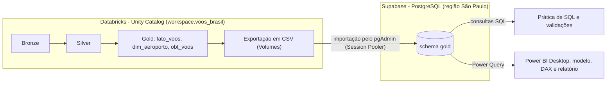
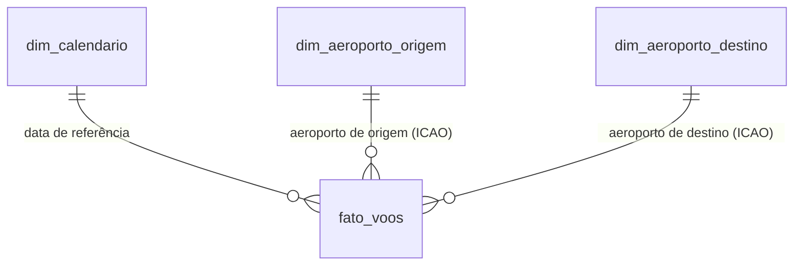

# Pipeline, infraestrutura e modelagem

## Pipeline Bronze, Silver e Gold

Este ponto é importante para a leitura correta do projeto.

| Etapa | Origem do material | Minha participação |
|---|---|---|
| Pipeline Bronze → Silver → Gold | Prompts e comandos disponibilizados pela Alura (https://github.com/Alura-Imersao-Engenharia-de-dados-2026/projeto-aviacao-anac) | Apliquei o material no Databricks, executei as etapas e acompanhei os resultados. **Não autorei esse pipeline.** |
| 3 desafios com IA | Enunciados da imersão | Escrevi os prompts enviados ao Genie Code e ao Genie Agent (tabela abaixo) |
| Migração para PostgreSQL | Decisão do meu projeto de portfólio | Provisionei o banco no Supabase, criei o schema e as tabelas, exportei os CSVs do Unity Catalog e importei pelo pgAdmin |
| Prática e validações em SQL | Exercícios em níveis e consultas de conferência | Resolvi os níveis 1 a 4 e executei as consultas de validação, interpretando os resultados |
| Modelagem, medidas e dashboard no Power BI | Referência de layout e de medidas de um analista de BI sênior, com apoio de IA | Montei o relatório, apliquei as correções de dados, criei e ajustei as medidas e defini a narrativa |

**Uso de IA:** na imersão, o Genie (Code e Agent) foi parte do método. Na construção do dashboard, usei um assistente de IA para tirar dúvidas, revisar medidas DAX e consultas SQL e organizar esta documentação. Executei e conferi as consultas e as medidas na base real.

Catálogo e schema no Databricks: `workspace.voos_brasil`.

**Bronze: dado bruto**
- Carga em PySpark a partir dos CSVs mensais, sem tipagem e sem filtros.
- Colunas de auditoria (`_arquivo_origem`, `_ingerido_em`).
- Carga idempotente (sobrescrita em tabela Delta); o uso de *time travel* (`DESCRIBE HISTORY`, `VERSION AS OF`) comprova que reprocessar não duplica dados.
- Quatro tabelas de referência: aeródromos, empresas nacionais, empresas estrangeiras e códigos de operação (esta última, uma tabela de apoio curada manualmente).
**Silver: espelho governado**
- Mesma contagem de linhas da Bronze, com **tipagem** (`try_cast` e `nullif`, para tratar o texto `'null'` e dois formatos de timestamp).
- Unificação de empresas nacionais e estrangeiras em uma única tabela.
- Métricas de aritmética pura (por exemplo, `atraso_partida_min`), **sem limiares de negócio**.
- Governança: `COMMENT` em tabelas e colunas e *tags* (camada, domínio, fonte, grão), conferidas via `information_schema`.
**Gold: dado pronto para consumo**
- `fato_voos`: tabela fato, com as regras de negócio aplicadas.
- `dim_aeroporto`: dimensão de aeroportos.
- `obt_voos`: tabela única desnormalizada, pensada para consumo por IA (Genie).
- Regras de negócio: **pontualidade com tolerância de 15 minutos**, **escopo doméstico/internacional** e **quarentena de atrasos fora de faixa**.
- Descrições geradas por IA são revisadas manualmente contra os dados antes de virarem `COMMENT`.

### Desafios com IA da imersão

Na imersão, usei os assistentes de IA do Databricks (Genie Code e Genie Agent) em três desafios, um por etapa do pipeline:

| # | Desafio | Ferramenta | O que foi pedido |
|---|---|---|---|
| 1 | Validação da camada Bronze | Genie Code | Conferir a carga e a estrutura da Bronze |
| 2 | Comparação Bronze × Silver | Genie Code | Documentar as transformações aplicadas entre as camadas |
| 3 | Perguntas de negócio sobre a Gold | Genie Agent | Atraso por companhia, sazonalidade mensal e rotas críticas entre São Paulo e Rio de Janeiro |

## Infraestrutura e fluxo dos dados

Esta parte descreve onde os dados vivem em cada etapa do projeto, como eles se movem entre as plataformas e por que cada serviço foi usado. O caminho completo é: **Databricks (processamento) → PostgreSQL no Supabase (banco para SQL e BI) → Power BI (análise e visualização)**.

### Papel de cada serviço

| Serviço | Papel no projeto |
|---|---|
| **Databricks** | Ambiente onde o pipeline medalhão foi executado (PySpark), com os assistentes Genie Code e Genie Agent |
| **Delta Lake** | Formato das tabelas Bronze, Silver e Gold; permitiu documentar a idempotência da carga com *time travel* |
| **Unity Catalog** | Catálogo e governança das tabelas (`workspace.voos_brasil`) e *Volumes*, de onde os CSVs da Gold foram exportados |
| **Supabase** | Plataforma que hospeda o PostgreSQL gerenciado em nuvem, em plano gratuito, na região de São Paulo (projeto `voos-brasil-portfolio`) |
| **PostgreSQL** | Banco relacional que recebeu as tabelas da Gold (schema `gold`); usado para praticar SQL, validar dados e alimentar o Power BI |
| **pgAdmin** | Cliente usado para conectar ao banco, importar os CSVs e executar consultas |
| **Power BI Desktop** | Conecta-se ao PostgreSQL, trata os dados no Power Query e publica a análise em uma página única |

### PostgreSQL no Supabase

**Por que um banco relacional à parte?** A camada Gold já estava pronta e tratada no Databricks. Reaproveitá-la em um PostgreSQL gerenciado permitiu praticar SQL em um banco convencional e conectar o Power BI Desktop sem depender de uma conta corporativa. O pipeline não foi refeito: o que migrou foi o dado já tratado.

**Estrutura criada**

- Projeto: `voos-brasil-portfolio`, região São Paulo (`sa-east-1`), plano gratuito.
- Schema: `gold`, com três tabelas que espelham as colunas da Gold do Databricks.
| Tabela no PostgreSQL | Linhas | Finalidade | Uso no relatório |
|---|---|---|---|
| `gold.fato_voos` | 1.014.705 | Fato: um registro por voo (etapa), com horários, atrasos em minutos e indicadores de pontualidade | Principal tabela do relatório |
| `gold.dim_aeroporto` | 496 | Dimensão de aeroportos (código ICAO, nome, município, UF e país) | Base das dimensões de aeroporto de origem e destino |
| `gold.obt_voos` | 1.014.705 | Tabela única desnormalizada, pensada para consumo por IA | Carregada no banco, não usada no relatório |

**Conexão.** O acesso é feito pelo **Session Pooler** do Supabase, necessário em redes IPv4. A conexão foi configurada e testada no pgAdmin antes de qualquer carga. As credenciais ficam fora deste repositório.

### Passo a passo da migração

1. **Provisionar o banco:** criação do projeto PostgreSQL gratuito no Supabase.
2. **Configurar o acesso:** conexão do pgAdmin ao banco pelo Session Pooler e teste de conexão.
3. **Criar a estrutura:** schema `gold` e as três tabelas, com as mesmas colunas da Gold do Databricks.
4. **Exportar a Gold:** geração dos CSVs a partir de Volumes do Unity Catalog.
5. **Importar os dados:** carga dos CSVs nas tabelas do schema `gold` pelo pgAdmin.
6. **Conferir a carga:** contagem de linhas (1.014.705 em `fato_voos` e `obt_voos`; 496 em `dim_aeroporto`), igual à origem.
7. **Validar e corrigir:** consultas de qualidade e correção do país dos aeroportos na dimensão (veja [decisões metodológicas](./decisoes-metodologicas.md)). A correção foi aplicada no PostgreSQL.
8. **Conectar o Power BI** ao schema `gold`.

### Integração com o Power BI

- O Power BI Desktop se conecta ao PostgreSQL do Supabase e carrega as tabelas pelo Power Query.
- No Power Query são aplicados o filtro de período (`data_ref` de 01/08/2025 a 31/07/2026, que reduz a base de 1.014.705 para 1.014.675 registros), a remoção de colunas de controle, a conversão dos indicadores de pontualidade para 0/1 e a criação das colunas `categoria_voo` e `tipo_operacao`.
- A partir daí, o modelo dimensional e as medidas DAX (veja [dashboard](./dashboard.md)) ficam no arquivo do Power BI.

### Desafios, segurança e limitações

| Desafio | Tratamento |
|---|---|
| Conexão ao Supabase a partir de uma rede IPv4 | Uso do **Session Pooler** em vez da conexão direta |
| Levar os dados do Databricks ao PostgreSQL | Exportação em CSV pelos Volumes do Unity Catalog e importação pelo pgAdmin |
| Dimensão de aeroportos com país incorreto | Correção por prefixo ICAO na dimensão do PostgreSQL (veja [decisões metodológicas](./decisoes-metodologicas.md)) |
| Carga de cerca de 1 milhão de linhas no Power BI | Exigiu atenção ao limite de tempo de consulta (*statement timeout*) do banco |

- **Credenciais fora do repositório.** Senhas, *strings* de conexão e arquivos de configuração não são versionados.
- **Dados públicos.** A base vem de dados abertos da ANAC e não contém dados pessoais.
- **Melhorias recomendadas** para um ambiente de produção (não implementadas neste projeto): usuário de banco com permissão somente leitura para o Power BI, rotação periódica de senhas e controle de acesso por tabela.

- O projeto trabalha com um **conjunto fechado de 12 meses**, carregado uma vez. Não há orquestração nem atualização automática da base.
- A cópia no PostgreSQL é um espelho da Gold no momento da exportação; a correção do país dos aeroportos foi aplicada nessa cópia, não na Gold do Databricks.
- O plano gratuito do Supabase tem limites de armazenamento, conexões e tempo de consulta, adequados a um projeto de portfólio, mas não a um uso em escala.

## Modelagem

O relatório usa um modelo dimensional simples, com uma tabela fato e três dimensões.

| Tabela | Tipo | Finalidade | Principais campos usados |
|---|---|---|---|
| `fato_voos` | Fato | Um registro por voo (etapa). Concentra horários, atrasos, indicadores de pontualidade e situação | Ver tabela abaixo |
| `dim_aeroporto_origem` | Dimensão | Aeroportos de origem, usados nos filtros e no gráfico por aeroporto | `Aeroporto` (rótulo "código + município", como SBGR GUARULHOS) e UF |
| `dim_aeroporto_destino` | Dimensão | A mesma dimensão, referenciada para o aeroporto de destino | Código ICAO e município |
| `dim_calendario` | Dimensão | Calendário que garante a ordem cronológica dos meses e dos dias da semana | `MesAno`, `MesAnoOrdem`, `DiaSemana`, `DiaSemanaNum` |

Relacionamentos: cada dimensão se liga à `fato_voos` em uma relação **um-para-muitos** (dimensão → fato). O calendário se liga pela data de referência do voo, e as dimensões de aeroporto pelo código ICAO de origem e de destino. A tabela `obt_voos`, também carregada no Supabase, não é usada no relatório.

**Colunas-chave da `fato_voos`**

| Coluna | O que representa |
|---|---|
| `tem_metrica` | Marca os voos com pontualidade avaliável (denominador do OTP) |
| `partida_pontual`, `chegada_pontual` | 1 se o atraso foi de até 15 minutos; 0 caso contrário; vazio quando o voo não é avaliável |
| `atraso_partida_min`, `atraso_chegada_min` | Atraso em minutos (valores negativos indicam adiantamento) |
| `minutos_recuperados` | Atraso na partida menos atraso na chegada |
| `atraso_gt60` | Indicador de atraso superior a 60 minutos |
| `voo_cancelado`, `voo_realizado` | Situação do voo |
| `hora_partida_prevista` | Hora prevista de partida (0 a 23) |
| `escopo_voo` | Doméstico ou internacional, conforme o tipo de linha da ANAC |
| `Companhia` | Nome da companhia usado nos filtros e no gráfico (a segmentação lista o nome completo da empresa; o gráfico usa o nome curto) |
| `categoria_voo` *(criada no Power Query)* | Funil dos registros: cancelado, avaliável, sem horário previsto ou quarentena |
| `tipo_operacao` *(criada no Power Query)* | Passageiros/mista × cargueira (preparada para análise futura; não usada no relatório) |

## Como reproduzir

1. **Dados:** obtenha os CSVs do VRA da ANAC e as tabelas Gold geradas pelo pipeline da imersão, ou use as três tabelas exportadas (`fato_voos`, `dim_aeroporto` e `obt_voos`).
2. **PostgreSQL:** crie um banco (por exemplo, no Supabase), crie o schema `gold` com as três tabelas e importe os CSVs (pgAdmin ou `COPY`). Em redes IPv4, conecte pelo Session Pooler.
3. **Validações:** execute [`funil_e_pontualidade`](../sql/02_funil_e_pontualidade.sql) e as validações de [decisões metodológicas](./decisoes-metodologicas.md) para conferir totais e o funil (1.014.705 registros e 778 em quarentena na base completa).
4. **Power BI:** conecte-se ao PostgreSQL e, no Power Query, filtre `data_ref` entre 01/08/2025 e 31/07/2026, descarte as colunas de controle, converta `partida_pontual` e `chegada_pontual` para inteiro (0/1) e crie `categoria_voo` e `tipo_operacao`.
5. **Modelo:** crie `dim_calendario` (com `MesAno`, `MesAnoOrdem`, `DiaSemana` e `DiaSemanaNum`) e as dimensões de aeroporto de origem e destino; relacione-as à `fato_voos`.
6. **Medidas e visuais:** crie as medidas de [`powerbi/medidas.dax`](../powerbi/medidas.dax) e monte a página conforme o [dashboard](./dashboard.md).
Credenciais de banco não devem ser versionadas.

---

[← Voltar ao README](../README.md)
